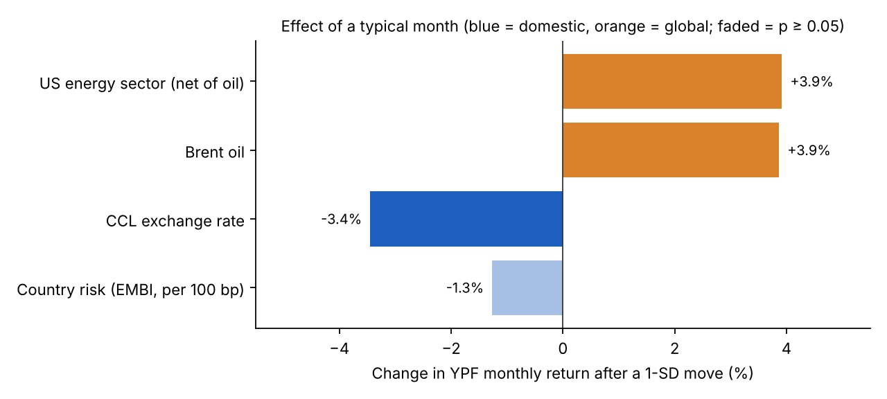
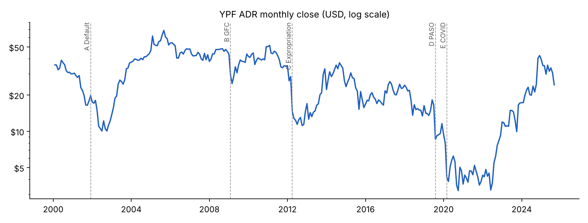

# What moves YPF's stock? Argentine macro risk vs. global energy

Econometric analysis of 25 years of monthly returns of YPF's NYSE-listed ADR (May 2000 – Sep 2025), measuring how much they relate to **domestic** risk (Argentine country risk and the CCL exchange rate) versus **global** energy factors (Brent crude and the US energy sector).

Undergraduate thesis research · B.A. in Economics, Universidad Nacional Arturo Jauretche (UNAJ).

**[Interactive dashboard (English)](https://matiasbatalla.github.io/portafolio-matias/tesis-ypf/)** · **[Versión en español](https://matiasbatalla.github.io/portafolio-matias/tesis-ypf/es.html)** · **[Notebook](notebooks/ypf_regression.ipynb)**



## Key findings

| Factor | Type | Coefficient | p-value | Effect of a 1-SD month |
|---|---|---:|---:|---:|
| US energy sector (net of oil) | Global | 0.726 | < 0.001 | +3.9% |
| Brent oil (log change) | Global | 0.399 | < 0.001 | +3.9% |
| CCL exchange rate (log change) | Domestic | −0.415 | < 0.001 | −3.4% |
| Country risk (per 100 bp) | Domestic | −0.0036 | 0.093 | −1.3% |

Adjusted R² = 0.343 · N = 305 · OLS with heteroskedasticity-robust (HC1) standard errors, plus dummies for systemic shocks (Feb 2009, Mar 2020) and the 2012 expropriation.

- Global energy factors and the CCL carry similar weight in YPF's monthly return.
- Country risk is weak on the full sample, but becomes significant (p ≈ 0.005) once the 2001–2005 default and debt-restructuring years are excluded.
- The results are consistent with the market pricing YPF both as a global oil company and as an Argentine peso asset. They describe statistical association, not causation.
- The results hold across 15 alternative specifications (see the dashboard or `data/robustness.csv`).



## Repository structure

```
├── data/
│   ├── ypf_monthly.csv          # Raw monthly series: YPF ADR, EMBI, Brent, CCL, S&P 500 Energy, dummies
│   ├── model_base.csv           # Transformed variables used in the regression (N = 305)
│   ├── model_coefficients.csv   # Final model estimates (country risk per 100 bp)
│   ├── model_fit.csv            # R², adjusted R², F statistic
│   └── robustness.csv           # 15 alternative specifications
├── notebooks/
│   └── ypf_regression.ipynb     # Reproduces the final model, effects and robustness
├── figures/                     # Charts exported by the notebook
├── index.html                   # Interactive dashboard (English)
└── es.html                      # Interactive dashboard (Spanish)
```

## Method

- **Dependent variable:** monthly log return of the YPF ADR (USD).
- **Domestic factors:** monthly change in JP Morgan's EMBI Argentina spread; log change of the CCL exchange rate.
- **Global factors:** log change of Brent; log return of the S&P 500 Energy index, orthogonalized to Brent (residual of regressing it on Brent) so the shared component is attributed to oil.
- **Shock dummies:** systemic (Feb 2009, Mar 2020) and regulatory (Apr 2012). Their standard errors are classical, since each flags only one or two months and the robust error collapses there.
- **CCL series:** official BCRA rate changes before Dec 2009; CCL implied by YPF's local share and ADR from Dec 2009 to Jul 2013; market CCL from Aug 2013. Versions with no mechanical link to YPF give the same result.
- **Excluded:** the Merval index, although highly significant, because YPF is one of its largest components.

The OLS and HC1 estimator are written out with NumPy in the notebook, so each step is explicit.

## Run it

```bash
pip install -r requirements.txt
jupyter notebook notebooks/ypf_regression.ipynb
```

## Data sources

Investing.com (YPF ADR, Brent, S&P 500 Energy) · Rava Bursátil (EMBI Argentina, CCL) · BCRA (official exchange rate) · valordolarblue (CCL).

## Author

**Matías Batalla** · B.A. in Economics, Universidad Nacional Arturo Jauretche · [Portfolio](https://matiasbatalla.github.io/portafolio-matias/)
